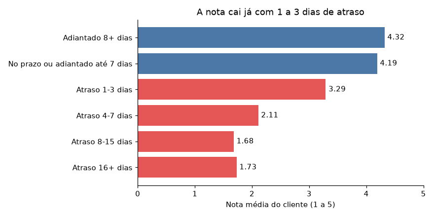
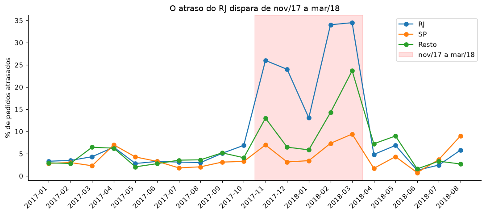
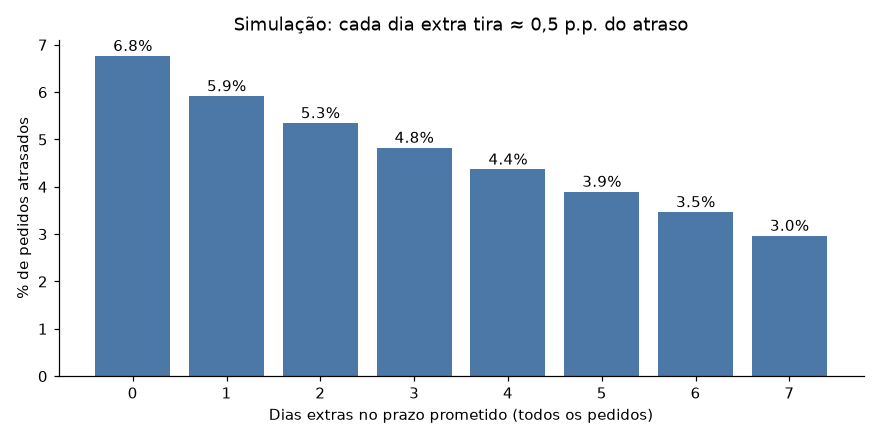

# Olist: o que explica o atraso nas entregas?

Análise de 96 mil pedidos entregues de um marketplace brasileiro (Olist, 2016–2018), feita com SQL (DuckDB) e Python. A pergunta: **onde e quando o prazo prometido deixa de ser cumprido, e quanto isso custa na nota do cliente?**

## Resumo

- **O atraso é raro, mas caro.** 6,8% dos pedidos chegam depois do prazo prometido. Eles recebem nota média 2,3 (contra 4,3 no prazo) e geram cerca de um terço de todas as notas 1 e 2.
- **A nota depende de cumprir o prazo, não de entregar rápido.** Com 1 a 3 dias de atraso, a nota já cai de 4,2 para 3,3. Entregar bem antes do prazo quase não muda a nota.
- **O atraso se concentra em poucos lugares.** SP e RJ somam 51% dos pedidos atrasados. O RJ atrasa 12,1% dos pedidos, contra 4,5% de SP.
- **O RJ tem um problema de pico. O Nordeste tem um problema fixo.** O RJ atrasa 4,3% fora do pico e 26,4% de nov/2017 a mar/2018. O Nordeste atrasa 9,3% mesmo fora do pico.
- **A promessa de prazo não acompanhou a realidade no RJ.** Na crise, o tempo real subiu 8,8 dias e o prazo prometido subiu 3.

## Dados

- Fonte: [Brazilian E-Commerce Public Dataset by Olist](https://www.kaggle.com/datasets/olistbr/brazilian-ecommerce) (Kaggle), licença [CC BY-NC-SA 4.0](https://creativecommons.org/licenses/by-nc-sa/4.0/). Os dados foram transformados nesta análise (agregados em 1 linha por pedido).
- 9 tabelas CSV. Os dados brutos **não** estão neste repositório. Baixe do Kaggle (veja "Como reproduzir").
- Pagamentos e geolocalização foram carregados, mas não entram nesta versão.
- Escopo: pedidos `delivered` com data de entrega preenchida. São 96.470 de 99.441 pedidos (97%).

## Método

- **Definição de atraso:** data de entrega maior que a data prometida, comparando só a data (sem hora). A data prometida vem com hora 00:00. Comparando o timestamp completo, a taxa sobe de 6,8% para 8,1%.
- **Tabela analítica:** 1 linha por pedido. Os itens são agregados antes do join, para o pedido não pesar mais por ter mais itens. Em pedidos com mais de um vendedor ou categoria, vale o item mais caro.
- **Qualidade dos dados:**
  - 8 pedidos `delivered` sem data de entrega: excluídos.
  - 23 pedidos com entrega antes da postagem: mantidos e marcados como inconsistentes.
  - Pedidos cancelados, indisponíveis e em trânsito: fora do escopo.
- **Regiões:** "Nordeste" = AL, MA, SE, PI, CE, BA, PE, PB, RN. "Pico" = pedidos de nov/2017 a mar/2018. Defini o pico depois de ver os dados (veja "Limitações").

## Achados

### 1. O atraso derruba a nota



- Pedidos atrasados: nota média 2,27 e 62% de notas 1 ou 2. Pedidos no prazo: nota 4,29 e 9% de notas 1 ou 2.
- Os 7% de pedidos atrasados geram cerca de um terço das notas baixas.
- A nota cai já com 1 a 3 dias de atraso (4,19 para 3,29) e para de piorar a partir de 8 dias.
- O atraso típico é grave: mediana de 7 dias, p90 de 22 dias. 71% dos atrasos passam de 3 dias.

### 2. O RJ tem um problema de pico. O Nordeste tem um problema fixo.



| Segmento | Atraso fora do pico | Atraso no pico |
|---|---|---|
| RJ | 4,3% | 26,4% |
| Nordeste | 9,3% | 19,4% |
| Resto | 3,4% | 8,6% |

- O RJ concentra 23% dos atrasos com 13% dos pedidos. 77% dos atrasos do RJ caem no pico.
- Em nov–dez/2017 o excesso é do RJ. Em fev–mar/2018 o problema é nacional, com o RJ pior.
- O Nordeste atrasa 2,7x o resto do país mesmo fora do pico.
- O tempo até a postagem (vendedor) ficou estável, entre 2,6 e 4,0 dias. O tempo de transporte subiu de ≈ 8,5 para 13 dias em fev–mar/2018. A base não tem a transportadora, então não identifica a causa.

### 3. No RJ, a promessa não acompanhou a realidade

| Período | Prometido (dias) | Real (dias) | Folga | Atraso no RJ |
|---|---|---|---|---|
| jul–out/2017 | 23,8 | 12,6 | 11,2 | 4,6% |
| nov/2017–mar/2018 | 26,8 | 21,4 | 5,4 | 26,4% |
| abr–jun/2018 | 33,1 | 12,6 | 20,5 | 4,5% |

- Na crise, o tempo real subiu 8,8 dias e a promessa subiu 3. A folga caiu pela metade.
- Depois da crise, a promessa ficou alta com o transporte já normal. Isso pode custar vendas, mas a base não mede isso.

### 4. Prazo maior reduz o atraso, mas só trata o sintoma



| Cenário (+3 dias de prazo) | Pedidos com prazo alterado | Atrasos evitados | Evitados por 1.000 |
|---|---|---|---|
| Todos | 96.203 | 1.869 | 19,4 |
| Só RJ e Nordeste, o ano todo | 21.325 | 548 | 25,7 |
| Todas as regiões, só no pico | 33.428 | 1.001 | 29,9 |
| Só RJ e Nordeste, no pico | 7.432 | 329 | 44,3 |

- Cada dia extra tira ≈ 0,5 ponto percentual do atraso. Não existe "ponto ideal".
- 74% dos pedidos já chegam 8 ou mais dias antes do prazo. Dar dias extras a todos pune quem não precisa.
- Quanto mais focado o cenário, mais cada prazo alterado rende, mas menor é o ganho total.

## Recomendações

1. **Prometer o que dá para cumprir.** Cumprir o prazo importa mais que a velocidade.
2. **Monitorar a folga por região** (prazo prometido menos prazo real). No RJ, o normal era ≈ 11 dias e a crise chegou a 5. Alertar quando a folga cair abaixo do normal da região.
3. **RJ:** plano de contingência para episódios de pico, acionado pelo alerta de folga (item 2) e não por calendário. Os dados mostram um único ciclo, então não dá para afirmar que o pico se repete em novembro.
4. **Nordeste:** investigar rotas e rever o prazo de forma permanente.
5. **Antes de mudar prazos em escala**, testar o efeito na conversão (teste A/B). A base não tem esse dado.

## Limitações

- **Só pedidos entregues.** Pedidos que nunca chegaram ficam fora, então o atraso real é maior que o medido.
- **Um único ciclo.** A janela do pico foi escolhida depois de ver os dados. Não há prova de sazonalidade.
- **Associação, não causa.** A queda da nota vem junto com o atraso. Outros fatores (produto, embalagem) não foram controlados.
- **A simulação é mecânica.** Ela assume que a entrega real e a nota não mudam com o prazo.
- **Sem transportadora e sem conversão.** A base não permite apontar o culpado do atraso nem medir o custo de prometer prazo maior.
- **Mesmo estado contra interestadual:** o comparativo é dominado por SP e não entra nas conclusões.
- **Estados pequenos** (RR, AP, AC) têm poucos pedidos e não sustentam conclusões.

## Como reproduzir

```
git clone https://github.com/Luis-Filipe-Santos/olist-delivery-delay.git
cd olist-delivery-delay
python -m venv .venv
.\.venv\Scripts\Activate.ps1        # Linux/macOS: source .venv/bin/activate
pip install -r requirements.txt
```

1. Baixe o dataset no Kaggle e coloque os 9 CSVs na pasta `data/`.
2. `python src/load_data.py` carrega os CSVs no DuckDB.
3. `python src/build_tabela.py` cria a tabela analítica (1 linha por pedido).
4. Rode `notebooks/01_qualidade.ipynb` e depois `notebooks/02_analise_atraso.ipynb`.

## Estrutura

```
├── data/        # CSVs (não versionados)
├── images/      # gráficos usados neste README
├── notebooks/   # 01 qualidade dos dados, 02 análise do atraso
├── sql/         # 01_tabela_analitica.sql
└── src/         # scripts de carga e de construção da tabela
```

## Próximos passos

- Backtest de uma regra de prazo dinâmico (P90 do tempo real recente, por estado).

## Licença e uso

- Os dados pertencem à Olist e seguem a licença CC BY-NC-SA 4.0: exigem crédito, proíbem uso comercial e pedem que obras derivadas usem a mesma licença.
- O texto e os gráficos desta análise seguem a mesma licença ([CC BY-NC-SA 4.0](https://creativecommons.org/licenses/by-nc-sa/4.0/)). Este repositório serve para estudo e portfólio.

## Autor

Luis Filipe Santos Silva · [LinkedIn](https://www.linkedin.com/in/luis-filipe-santos-silva)